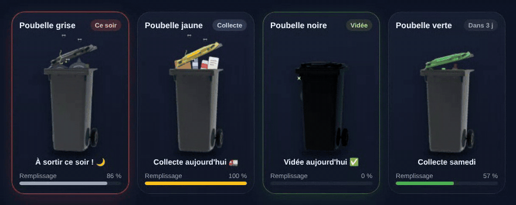
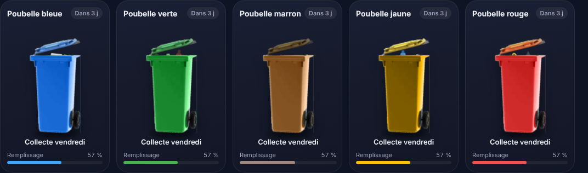
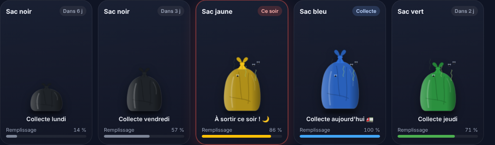

# 🗑️ Poubelle Card

[English](README.md) · **Français**


Carte Lovelace animée pour Home Assistant : la poubelle se remplit au fil des jours, tremble la veille de la collecte, saute le jour J et brille une fois vidée.



## ✨ Fonctionnalités

| État | Quand | Animation |
|---|---|---|
| Normal | les autres jours | le contenu monte, le couvercle s'entrouvre |
| Plein (≥ 60 %) | fin de cycle | mouches 🪰 + odeurs, sacs qui gigotent |
| **Ce soir** | veille de collecte | la poubelle tremble, bordure rouge |
| **Collecte** | jour J, avant l'heure de passage | la poubelle sautille |
| **Vidée** | jour J, après l'heure de passage | étincelles ✨, bordure verte |

- 10 couleurs : `grey`, `black`, `yellow`, `green`, `blue`, `brown`, `red`, `purple`, `burgundy`, `lime` (les noms français `grise`, `noire`, `jaune`, `violette`, `bordeaux`… restent acceptés)
- **Bac entièrement coloré** (`full_color: true`) ou couvercle seul
- **Sac poubelle** (`container: bag`), **encombrants** (`container: bulky`) ou ta propre image (`image`)
- Plannings : chaque semaine, **toutes les N semaines à partir d'une date**, semaines paires / impaires, une fois par mois, collectes saisonnières
- **Jours fériés** via l'intégration [Holiday](https://www.home-assistant.io/integrations/holiday), **jour ouvré suivant** via l'intégration [Workday](https://www.home-assistant.io/integrations/workday)
- Ou une entité : capteur date, nombre de jours, `calendar`, [Waste Collection Schedule](https://github.com/mampfes/hacs_waste_collection_schedule)
- Carte et éditeur visuel dans la **langue de Home Assistant** automatiquement (anglais, français, serbe cyrillique et latin ; les autres langues passent en anglais)
- Aucune dépendance, respecte `prefers-reduced-motion`

## 📦 Installation

Nécessite **Home Assistant 2026.1** ou plus récent.

### HACS (recommandé)
1. HACS → ⋮ → **Dépôts personnalisés** → ajoute `https://github.com/Roving-Ronin/ha-garbage-card`, type **Tableau de bord** (*Dashboard*).
2. Cherche **Poubelle Card** → Télécharger.
3. Recharge le navigateur (Ctrl + F5).

### Manuelle
1. Télécharge `poubelle-card.js` depuis la [dernière version](https://github.com/Roving-Ronin/ha-garbage-card/releases/latest) et copie-le dans `/config/www/`.
2. Paramètres → Tableaux de bord → ⋮ → Ressources → ajoute `/local/poubelle-card.js` (type *Module JavaScript*).

## ⚙️ Configuration

Tout se règle dans l'éditeur visuel. Exemples YAML :

### Jours fixes
```yaml
type: custom:poubelle-card
bin: black
name: Poubelle noire
days: [mardi, vendredi]   # ou [1, 4] (0 = lundi … 6 = dimanche)
hour: 9                   # heure de passage du camion
```

### Toutes les N semaines à partir d'une date
`start_date` est n'importe quelle date de collecte, passée ou à venir. Les collectes se répètent toutes les `every` semaines, dans les deux sens. Le jour de la semaine est celui de `start_date`, sauf si `days` est indiqué.
```yaml
type: custom:poubelle-card
bin: yellow
start_date: 2026-11-04
every: 2                  # 1 = chaque semaine, 2 = une semaine sur deux, 4 = toutes les 4 semaines
```

### Jours fériés
Ajoute l'intégration **Holiday** (Paramètres → Appareils et services → Ajouter une intégration → Holiday) pour ton pays et ta région (ex. Alsace-Moselle). La carte trouve son calendrier toute seule, ou tu peux le choisir avec `holiday_calendar`.

```yaml
type: custom:poubelle-card
bin: grey
days: [lundi, jeudi]
holidays: next_work_day
```

| `holidays` | Une collecte qui tombe un jour férié… | Nécessite |
|---|---|---|
| `none` (défaut) | n'est pas modifiée | — |
| `next_day` | est reportée au lendemain | Holiday |
| `next_work_day` | est reportée au jour ouvré suivant | Holiday + Workday |
| `shift_week` | est reportée au même jour la semaine suivante (et encore si ce jour est aussi férié) | Holiday |
| `shift_rest_of_week` | elle et les collectes suivantes de la semaine sont décalées d'un jour (ancien `decalage`) | Holiday |
| `cancel` | est annulée | Holiday |

`next_work_day` utilise le calendrier de l'intégration **Workday** (week-ends, jours exclus, jours fériés ajoutés ou retirés). Sans elle, la carte saute les fériés et les dimanches et affiche un avertissement.

Quand une collecte est déplacée, la carte l'indique : « Collecte mardi · décalée (jour férié) ». Des dates ponctuelles peuvent être ajoutées avec `holiday_dates: ["2026-12-24"]`.

### Bac entièrement coloré
```yaml
type: custom:poubelle-card
bin: blue
days: [mardi]
full_color: true
```


### Sac poubelle (communes sans conteneurs)
```yaml
type: custom:poubelle-card
bin: yellow
container: bag
days: [jeudi]
```


### Encombrants
```yaml
type: custom:poubelle-card
container: bulky
month_week: 1        # 1er mercredi du mois
days: [mercredi]
```

### Image perso
```yaml
type: custom:poubelle-card
container: bulky
image: /local/encombrants.png
days: [mercredi]
month_week: 1
```

### Collectes saisonnières
```yaml
type: custom:poubelle-card
bin: green
name: Végétaux
days: [vendredi]
months: [5, 6, 7, 8, 9, 10]   # de mai à octobre (ou [mai, juin, …])
```

### Semaines paires / impaires
```yaml
type: custom:poubelle-card
bin: yellow
days: [mardi]
weeks: even        # semaines ISO paires ; l'autre bac : weeks: odd
```

### Une fois par mois
```yaml
type: custom:poubelle-card
bin: blue
days: [mardi]
month_week: 1        # 1er mardi du mois (2, 3, 4 ou last = dernier)
```
```yaml
type: custom:poubelle-card
bin: green
month_day: 15        # le 15 de chaque mois
```

### Avec une entité ou un calendrier
```yaml
type: custom:poubelle-card
bin: yellow
entity: calendar.collectes
calendar_filter: Tri            # ou une liste : [Tri, Emballages]
hour: 6
```
L'événement est la veille de la collecte (« Sortir les poubelles ») ? Ajoute `calendar_offset: 1`. Avec un capteur, `interval` (jours entre deux collectes) sert à estimer le remplissage.

### Options
La liste complète des options est dans le [README anglais](README.md#options) ; les noms d'options sont les mêmes. `language: fr` force le français, sinon la carte suit la langue du profil HA.

## 🔄 Mise à jour depuis 1.x

Les tableaux de bord existants continuent de fonctionner : les valeurs françaises (`noire`, `sac`, `paires`, `report`, `annule`…) restent acceptées, et l'éditeur visuel les affiche avec leur équivalent anglais.

- **Home Assistant 2026.1** minimum.
- Les **jours fériés** viennent maintenant de l'intégration Holiday au lieu de la liste française intégrée ; `region` n'est plus utilisé (choisis la région dans l'intégration Holiday).
- **`holidays: next_day` signifie maintenant le lendemain.** L'ancien comportement (jour suivant non férié et non dimanche) s'appelle `next_work_day` ; `report` et `shift` y correspondent.
- `decalage` s'appelle désormais `shift_rest_of_week` (même comportement). `shift_week` est nouveau : la collecte est reportée d'une semaine.

## 📄 Licence
MIT. Basé sur [skyrotter/ha-poubelle-card](https://github.com/skyrotter/ha-poubelle-card).
