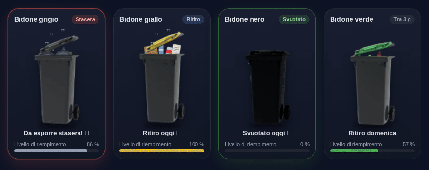
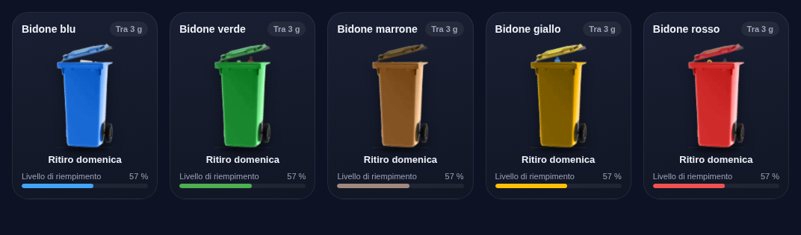
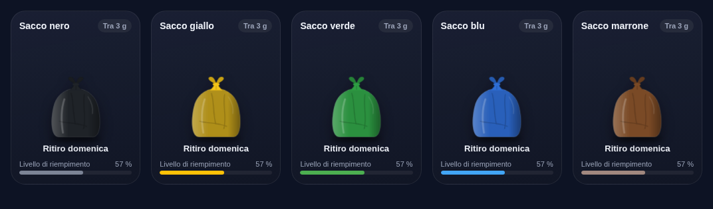

# 🗑️ Poubelle Card

[Français](README.md) · [English](README.en.md) · **Italiano**


Card Lovelace animata per i giorni di raccolta dei rifiuti: il bidone si riempie nel corso del ciclo, trema la sera prima del ritiro, salta il giorno del ritiro e brilla una volta svuotato.



## ✨ Funzionalità

| Stato | Quando | Animazione |
|---|---|---|
| Normale | negli altri giorni | il contenuto sale, il coperchio si solleva |
| Pieno (≥ 60 %) | fine del ciclo | mosche 🪰 e cattivi odori, i sacchi ondeggiano |
| **Stasera** | il giorno prima del ritiro | il bidone trema, bordo rosso |
| **Ritiro** | giorno del ritiro, prima del camion | il bidone salta |
| **Svuotato** | giorno del ritiro, dopo il camion | scintille ✨, bordo verde |

- 10 colori: `grey`, `black`, `yellow`, `green`, `blue`, `brown`, `red`, `purple`, `burgundy`, `lime`
- **Bidone interamente colorato** (`full_color: true`) oppure solo il coperchio colorato
- **Sacco della spazzatura** (`container: bag`) e mucchio di **rifiuti ingombranti** (`container: bulky`), oppure una tua immagine (`image`)
- Programmi: settimanale, **ogni N settimane a partire da una data** (ogni due settimane, ogni quattro…), settimane pari/dispari, una volta al mese, mesi stagionali
- **Giorni festivi** dall'integrazione [Holiday](https://www.home-assistant.io/integrations/holiday), **giorno lavorativo successivo** dall'integrazione [Workday](https://www.home-assistant.io/integrations/workday)
- Oppure leggi la data da un'entità: sensore data, sensore dei giorni mancanti, `calendar`, [Waste Collection Schedule](https://github.com/mampfes/hacs_waste_collection_schedule)
- La card e l'editor visuale seguono automaticamente la **lingua di Home Assistant** (inglese, francese, italiano, olandese, serbo (cirillico e latino); le altre lingue ripiegano sull'inglese)
- Nessuna dipendenza, rispetta `prefers-reduced-motion`

## 📦 Installazione

Richiede **Home Assistant 2026.1** o successivo.

### HACS (consigliato)
1. HACS → ⋮ → **Repository personalizzati** → aggiungi `https://github.com/skyrotter/ha-poubelle-card`, tipo **Dashboard**.
2. Cerca **Poubelle Card** → Scarica.
3. Ricarica il browser (Ctrl + F5).

### Manuale
1. Scarica `poubelle-card.js` dall'[ultima versione](https://github.com/skyrotter/ha-poubelle-card/releases/latest) e copialo in `/config/www/`.
2. Impostazioni → Dashboard → ⋮ → Risorse → aggiungi `/local/poubelle-card.js` (tipo *Modulo JavaScript*).

## ⚙️ Configurazione

Tutto si può impostare dall'editor visuale. Esempi YAML:

### Settimanale
```yaml
type: custom:poubelle-card
bin: red
name: Indifferenziato
days: [tuesday, friday]   # oppure [1, 4] (0 = lunedì … 6 = domenica)
hour: 6                   # ora di passaggio del camion
```

### Bidoni
Coperchi tipici: grigio `grey` secco residuo / indifferenziato, gialo `yellow` plastica, marrone `brown` rifiuti alimentari / organico, verde `green` vetro, blu `blue` carta. I comuni differiscono, quindi scegli il colore del tuo coperchio e imposta `content` per ciò che vi si getta.
```yaml
type: custom:poubelle-card
bin: brown
name: Organico
content: organics
start_date: 2026-11-04
every: 2
full_color: true
```

### Ogni N settimane a partire da una data (riciclabili ogni due settimane)
`start_date` è una qualsiasi data in cui il bidone è stato o sarà ritirato. I ritiri si ripetono ogni `every` settimane a partire da essa, in avanti e all'indietro. Il giorno della settimana è quello di `start_date`, a meno che tu non imposti `days`.
```yaml
type: custom:poubelle-card
bin: yellow
start_date: 2026-11-04    # un mercoledì di ritiro dei riciclabili noto
every: 2                  # 1 = ogni settimana, 2 = ogni due settimane, 4 = ogni quattro settimane
```
Riciclabili e rifiuti da giardino a settimane alterne? Dai alla seconda card una data di inizio spostata di una settimana.

### Giorni festivi
Aggiungi l'integrazione **Holiday** (Impostazioni → Dispositivi e servizi → Aggiungi integrazione → Holiday) per il tuo paese e la tua regione. La card trova da sola il relativo calendario, oppure puoi sceglierlo con `holiday_calendar`.

```yaml
type: custom:poubelle-card
bin: red
days: [friday]
holidays: next_work_day
```

| `holidays` | Un ritiro che cade in un giorno festivo… | Richiede |
|---|---|---|
| `none` (predefinito) | non viene modificato | — |
| `next_day` | passa al giorno di calendario successivo | Holiday |
| `next_work_day` | passa al giorno lavorativo successivo | Holiday + Workday |
| `shift_week` | passa allo stesso giorno della settimana seguente (e ancora se anche quel giorno è festivo) | Holiday |
| `shift_rest_of_week` | esso e i restanti ritiri di quella settimana slittano di un giorno | Holiday |
| `cancel` | non avviene | Holiday |

`next_work_day` usa il calendario dell'integrazione **Workday**, quindi vengono rispettati i tuoi fine settimana, i giorni esclusi e i festivi aggiunti o rimossi. Senza di essa, la card salta i festivi e le domeniche e mostra un avviso.

Quando un ritiro viene spostato la card lo indica: «Ritiro martedì · spostato (giorno festivo)». Si possono aggiungere date straordinarie con `holiday_dates: ["2026-12-24"]`.

### Bidone interamente colorato
Per impostazione predefinita è colorato solo il coperchio. Con `full_color` lo è l'intero bidone (la ruota resta nera), il che è più leggibile quando affianchi più bidoni.
```yaml
type: custom:poubelle-card
bin: blue
days: [tuesday]
full_color: true
```


### Sacco della spazzatura
Un sacco chiuso sostituisce il bidone con ruote. All'inizio del ciclo è piatto e si gonfia fino al giorno del ritiro. Il sacco giallo è traslucido, come i sacchi per i riciclabili.
```yaml
type: custom:poubelle-card
bin: yellow
container: bag
days: [thursday]
```


### Rifiuti ingombranti
Un mucchio di oggetti (frigorifero, materasso, TV, pneumatico, scatolone…) che cresce fino al giorno del ritiro. `bin` è facoltativo (indicatore grigio per impostazione predefinita).
```yaml
type: custom:poubelle-card
container: bulky
month_week: 1        # primo mercoledì del mese
days: [wednesday]
```

### Immagine personalizzata
`image` sostituisce il disegno con una tua immagine (PNG o SVG, meglio su sfondo trasparente), qualunque sia il contenitore.
```yaml
type: custom:poubelle-card
container: bulky
image: /local/bulky.png
days: [wednesday]
month_week: 1
```

### Ritiri stagionali
`months` limita i ritiri ad alcuni mesi (numeri o nomi). Fuori stagione la card mostra la data del prossimo ritiro.
```yaml
type: custom:poubelle-card
bin: green
name: Rifiuti da giardino
days: [friday]
months: [9, 10, 11, 12, 1, 2, 3]
```

### Settimane pari / dispari
```yaml
type: custom:poubelle-card
bin: yellow
days: [tuesday]
weeks: even        # numeri di settimana ISO; l'altro bidone: weeks: odd
```
Per i ritiri a settimane alterne, `start_date` + `every: 2` è di solito più semplice da far coincidere con il calendario del tuo comune.

### Una volta al mese
```yaml
type: custom:poubelle-card
bin: blue
days: [tuesday]
month_week: 1        # 1° martedì del mese (2, 3, 4 oppure last)
```
```yaml
type: custom:poubelle-card
bin: green
days: [saturday]
month_week: [2, 4]   # 2° e 4° sabato
```
```yaml
type: custom:poubelle-card
bin: green
month_day: 15        # il 15 di ogni mese
```

### Da un'entità
```yaml
type: custom:poubelle-card
bin: yellow
entity: sensor.recycling_pickup   # data, giorni mancanti, calendar.*, Waste Collection Schedule…
interval: 14                      # giorni tra un ritiro e l'altro (per il livello di riempimento)
hour: 6
```

### Da un calendario
Un solo calendario per tutti i bidoni? `calendar_filter` mantiene solo gli eventi il cui titolo contiene questo testo (senza distinzione tra maiuscole e minuscole). Il livello di riempimento segue allora il reale ritiro precedente, quindi `interval` non serve.
```yaml
type: custom:poubelle-card
bin: yellow
entity: calendar.bin_collections
calendar_filter: Recycling      # oppure una lista: [Recycling, Paper]
hour: 6
```
L'evento è il giorno prima del ritiro («Esporre i bidoni»)? Aggiungi `calendar_offset: 1`.

### Due card affiancate (vista a sezioni)
```yaml
type: grid
columns: 2
square: false
cards:
  - type: custom:poubelle-card
    bin: red
    days: [1, 4]
    compact: true
    show_meter: false
    scale: 0.47
    headroom: 20
  - type: custom:poubelle-card
    bin: yellow
    start_date: 2026-11-04
    every: 2
    compact: true
    show_meter: false
    scale: 0.47
    headroom: 20
```

### Opzioni

| Opzione | Tipo | Predefinito | Descrizione |
|---|---|---|---|
| `bin` | testo | **obbligatorio** (tranne ingombranti) | `grey`, `black`, `yellow`, `green`, `blue`, `brown`, `red`, `purple`, `burgundy`, `lime` |
| `name` | testo | dal colore | Titolo della card |
| `days` | lista | — | Giorni di ritiro: numeri (0 = lunedì) o nomi (`tuesday`, `tue`). Obbligatorio a meno che non sia impostato `start_date`, `month_day` o `entity` |
| `start_date` | data | — | Una data di ritiro nota; i ritiri si ripetono ogni `every` settimane a partire da essa. Prevale su `weeks` |
| `every` | numero | `1` | Settimane tra un ritiro e l'altro, contate da `start_date` |
| `weeks` | testo | tutte | `even` / `odd`: una settimana sì e una no, in base al numero di settimana ISO |
| `month_week` | testo / lista | — | Solo il `1`°, `2`°, `3`°, `4`° oppure l'ultimo (`last`) giorno della settimana indicato del mese; è possibile una lista: `[2, 4]` |
| `month_day` | numero | — | Una volta al mese in una data fissa (1–31; 31 = ultimo giorno del mese). Sostituisce `days` |
| `months` | lista | tutto l'anno | Mesi di ritiro: numeri (`5` = maggio) o nomi. Si combina con le opzioni precedenti |
| `holidays` | testo | `none` | `none`, `next_day`, `next_work_day`, `shift_week`, `shift_rest_of_week`, `cancel` (vedi sopra) |
| `holiday_calendar` | entità | auto | Calendario dell'integrazione Holiday |
| `workday_calendar` | entità | auto | Calendario dell'integrazione Workday (per `next_work_day`) |
| `holiday_dates` | lista | — | Date aggiuntive trattate come festive, es. `["2026-12-24"]` |
| `entity` | entità | — | Fonte del prossimo ritiro (vedi sotto). Il clic apre le informazioni dell'entità |
| `hour` | numero | `9` | Ora di passaggio del camion (sono ammessi decimali: `6.5` = 6:30) |
| `calendar_filter` | testo / lista | — | Con un'entità `calendar.*`: solo gli eventi il cui titolo contiene questo testo |
| `calendar_offset` | numero | `0` | Giorni tra l'evento del calendario e il ritiro (`1` se l'evento è il giorno prima) |
| `interval` | numero | `7` | Giorni tra un ritiro e l'altro (solo per le entità sensore, per il livello di riempimento) |
| `content` | testo | dal colore | Cosa sporge quando è pieno: secco residuo `rubbish`, plastica e/o alluminio `recycling`, vetro `glass`, carta `paper`, organico `organics`. I colori hanno significati diversi nei vari comuni, quindi impostalo in modo che corrisponda al tuo |
| `color` | colore CSS | dal colore | Colore dell'indicatore |
| `full_color` | booleano | `false` | Colora l'intero bidone, non solo il coperchio |
| `body_color` | colore CSS | dal colore | Colore del bidone con `full_color` |
| `container` | testo | `wheelie_bin` | `wheelie_bin`, `bag` (sacco della spazzatura) o `bulky` (mucchio di rifiuti ingombranti) |
| `image` | URL | — | Una tua immagine al posto del disegno, es. `/local/bulky.png` |
| `lid_filter` / `body_filter` | filtro CSS | — | Tinta personalizzata, es. `hue-rotate(90deg)` |
| `scale` | numero | `0.62` | Dimensione del bidone |
| `headroom` | px | `70` | Spazio sopra il bidone (per il coperchio aperto) |
| `compact` | booleano | `false` | Margini ridotti |
| `show_meter` | booleano | `true` | Indicatore di riempimento |
| `show_status` | booleano | `true` | Testo sotto il bidone |
| `theme_background` | booleano | `false` | Usa lo sfondo delle card del tema di HA |
| `language` | testo | `auto` | `auto` (la lingua del tuo profilo HA), `en`, `fr`, `it`, `nl`, `sr`, `sr-Latn` |

### Entità supportate
- **Waste Collection Schedule**: attributo `daysTo`
- `sensor` il cui stato è una **data** (`2026-10-20`), un **timestamp**, un **numero di giorni** (`3`) oppure `today` / `tomorrow`
- `calendar.*`: eventi dei 60 giorni passati e dei 60 successivi, filtrabili per titolo (`calendar_filter`)
- `input_datetime` (con una data)

### Stile con card-mod / temi
Variabili CSS: `--poubelle-card-background`, `--poubelle-card-border-color`, `--poubelle-card-text-color`, `--poubelle-card-secondary-color`. Classi di stato su `ha-card`: `veille` (stasera), `jour` (ritiro), `videe` (svuotato), `plein` (pieno).

## 🔄 Aggiornamento dalla 1.x

I dashboard esistenti continuano a funzionare: i valori francesi (`noire`, `sac`, `paires`, `report`, `annule`…) sono ancora accettati e l'editor visuale li mostra con il loro equivalente inglese.

- È richiesto **Home Assistant 2026.1 o successivo**.
- I **giorni festivi** ora provengono dall'integrazione Holiday anziché da un elenco francese integrato. Se usi `holidays`, aggiungi l'integrazione Holiday per il tuo paese (e la tua regione); `region` non viene più usato.
- **`holidays: next_day` ora significa il giorno di calendario successivo.** Il vecchio comportamento (primo giorno successivo che non sia festivo né domenica) è `next_work_day`; `report` e `shift` vi corrispondono.
- `decalage` ora si chiama `shift_rest_of_week` (stesso comportamento). `shift_week` è nuovo: il ritiro slitta di un'intera settimana.

## 📄 Licenza
MIT
