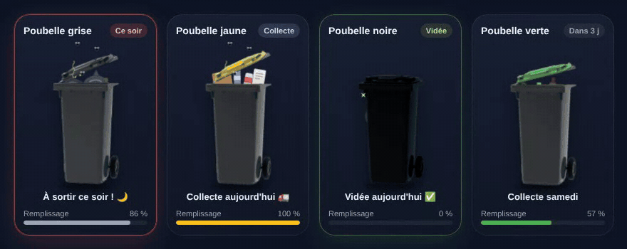

# 🗑️ Poubelle Card

[](https://hacs.xyz/docs/faq/custom_repositories)


Carte Lovelace animée pour Home Assistant : la poubelle se remplit au fil des jours, tremble la veille de la collecte, saute le jour J et brille une fois vidée.
*Animated Lovelace card for Home Assistant bin collection days — [English below](#-english).*



## ✨ Fonctionnalités

| État | Quand | Animation |
|---|---|---|
| Normal | les autres jours | le contenu monte, le couvercle s'entrouvre |
| Plein (≥ 60 %) | fin de cycle | mouches 🪰 + odeurs, sacs qui gigotent |
| **Ce soir** | veille de collecte | la poubelle tremble, bordure rouge |
| **Collecte** | jour J, avant l'heure de passage | la poubelle sautille |
| **Vidée** | jour J, après l'heure de passage | étincelles ✨, bordure verte |

- 7 couleurs : `grise`, `noire`, `jaune`, `verte`, `bleue`, `marron`, `rouge`
- Contenu adapté : sacs d'ordures, emballages, verre, papier, biodéchets
- Deux sources : **jours fixes** (YAML) ou **entité** (capteur date, nombre de jours, `calendar`, [Waste Collection Schedule](https://github.com/mampfes/hacs_waste_collection_schedule))
- Français / anglais automatique (langue du profil HA)
- Éditeur visuel, aucune dépendance, respecte `prefers-reduced-motion`

## 📦 Installation

### HACS (recommandé)
1. HACS → ⋮ → **Dépôts personnalisés** → ajoute `https://github.com/skyrotter/ha-poubelle-card`, type **Tableau de bord** (*Dashboard*).
2. Cherche **Poubelle Card** → Télécharger.
3. Recharge le navigateur (Ctrl + F5).

### Manuelle
1. Copie `poubelle-card.js` dans `/config/www/`.
2. Paramètres → Tableaux de bord → ⋮ → Ressources → ajoute `/local/poubelle-card.js` (type *Module JavaScript*).

## ⚙️ Configuration

### Jours fixes
```yaml
type: custom:poubelle-card
bin: noire
name: Poubelle noire
days: [mardi, vendredi]   # ou [1, 4] (0 = lundi … 6 = dimanche)
hour: 9                   # heure de passage du camion
```

### Une semaine sur deux (semaines paires / impaires)
```yaml
type: custom:poubelle-card
bin: jaune
days: [mardi]
weeks: paires      # semaines ISO paires ; la grise : weeks: impaires
```

### Jours fériés
Chaque commune a sa règle : vérifie le calendrier de collecte de ta mairie / métropole.
```yaml
type: custom:poubelle-card
bin: grise
days: [lundi, jeudi]
holidays: decalage    # report | decalage | annule
```
Quand une collecte est déplacée, la carte l'indique : « Collecte mardi · décalée (jour férié) ».

### Avec une entité
```yaml
type: custom:poubelle-card
bin: jaune
entity: sensor.collecte_jaune   # date, nb de jours, calendar.*, Waste Collection Schedule…
interval: 14                    # jours entre deux collectes (calcul du remplissage)
hour: 6
```

### Deux cartes côte à côte (vue sections)
```yaml
type: grid
columns: 2
square: false
cards:
  - type: custom:poubelle-card
    bin: noire
    days: [1, 4]
    compact: true
    show_meter: false
    scale: 0.47
    headroom: 20
  - type: custom:poubelle-card
    bin: jaune
    days: [1]
    compact: true
    show_meter: false
    scale: 0.47
    headroom: 20
```

### Options

| Option | Type | Défaut | Description |
|---|---|---|---|
| `bin` | texte | **obligatoire** | `grise`, `noire`, `jaune`, `verte`, `bleue`, `marron`, `rouge` (noms anglais acceptés) |
| `name` | texte | selon la couleur | Titre de la carte |
| `days` | liste | — | Jours de collecte : nombres (0 = lundi) ou noms (`mardi`, `tuesday`…). Obligatoire sans `entity` |
| `weeks` | texte | toutes | `paires` / `impaires` (`even` / `odd`) : collecte une semaine sur deux, selon le numéro de semaine ISO |
| `holidays` | texte | `aucun` | Jours fériés français : `report` (collecte reportée au lendemain), `decalage` (à partir du férié, toutes les collectes de la semaine décalées d'un jour), `annule` (pas de collecte) |
| `region` | texte | `metropole` | `alsace-moselle` ajoute le Vendredi saint et le 26 décembre |
| `holiday_dates` | liste | — | Dates supplémentaires traitées comme fériées, ex. `["2026-12-24"]` |
| `entity` | entité | — | Source de la prochaine collecte (voir ci-dessous). Clic = fenêtre d'info |
| `hour` | nombre | `9` | Heure de passage (décimales acceptées : `6.5` = 6 h 30) |
| `interval` | nombre | `7` | Jours entre deux collectes (mode entité uniquement) |
| `content` | texte | selon la couleur | `ordures`, `recyclables`, `verre`, `papier`, `biodechets` |
| `color` | couleur CSS | selon la couleur | Couleur de la jauge |
| `lid_filter` / `body_filter` | filtre CSS | — | Teinte personnalisée, ex. `hue-rotate(90deg)` |
| `scale` | nombre | `0.62` | Taille de la poubelle |
| `headroom` | px | `70` | Espace au-dessus (pour le couvercle ouvert) |
| `compact` | booléen | `false` | Marges réduites |
| `show_meter` | booléen | `true` | Jauge de remplissage |
| `show_status` | booléen | `true` | Texte sous la poubelle |
| `theme_background` | booléen | `false` | Utilise le fond de carte du thème HA |
| `language` | `auto`/`fr`/`en` | `auto` | Langue |

### Entités prises en charge
- **Waste Collection Schedule** : attribut `daysTo`
- `sensor` dont l'état est une **date** (`2026-10-20`), un **horodatage**, un **nombre de jours** (`3`) ou `today`/`tomorrow`/`aujourd'hui`/`demain`
- `calendar.*` : attribut `start_time` du prochain événement
- `input_datetime` (avec date)

### Personnaliser via card-mod / thème
Variables CSS : `--poubelle-card-background`, `--poubelle-card-border-color`, `--poubelle-card-text-color`, `--poubelle-card-secondary-color`.

---

## 🇬🇧 English

Animated bin card: the bin fills up over the week, shakes the evening before pickup, hops on pickup day and sparkles once emptied.

**Install:** HACS → ⋮ → Custom repositories → `https://github.com/skyrotter/ha-poubelle-card` (type *Dashboard*) → download **Poubelle Card**. Manual: copy `poubelle-card.js` to `/config/www/` and add `/local/poubelle-card.js` as a JavaScript module resource.

```yaml
type: custom:poubelle-card
bin: yellow          # grey, black, yellow, green, blue, brown, red
days: [tuesday]      # or [1] — 0 = Monday
hour: 9              # truck pickup hour
# weeks: even        # every other week: even / odd ISO weeks
# holidays: report    # French public holidays: report | decalage | annule
# entity: sensor.next_yellow_pickup   # date / days-left / calendar / Waste Collection Schedule
# interval: 14
```

All options are listed in the table above (`language: en` forces English; otherwise it follows your HA profile language).

## 📄 Licence
MIT
